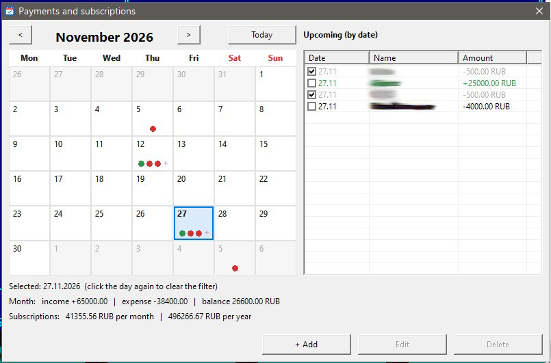

# Платежи и подписки / Payments and Subscriptions

## Русский

Версия 1.0.

Программа для Windows помогает вести календарь платежей и приходов, отслеживать подписки и получать напоминания. Поддерживаются повторяющиеся записи и платежи из накоплений, которые не уменьшают расчётный баланс повторно.

Программа работает в системном трее. Язык интерфейса можно переключить между русским и английским через меню значка.

[Руководство пользователя](Doc/USER_GUIDE_RU.md) — работа с программой, примеры, резервное копирование и перенос данных.

[Лицензия](LICENSE) — только некоммерческое использование.

## English

Version 1.0.

A Windows application for tracking payments and income, managing subscriptions, and receiving reminders. It supports recurring entries and payments from savings that do not reduce the calculated balance a second time.

The application runs in the system tray. Use the tray icon menu to switch between English and Russian.

[User guide](Doc/USER_GUIDE_EN.md) — using the application, examples, backups, and data migration.

[License](LICENSE) — non-commercial use only.
